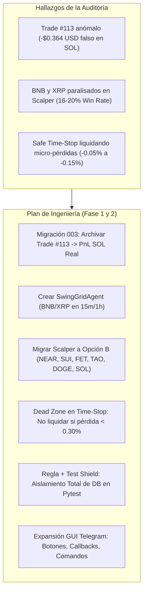
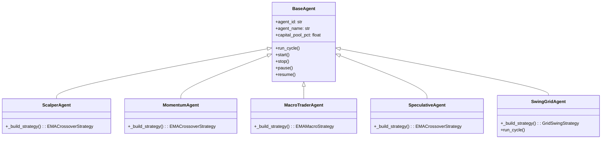
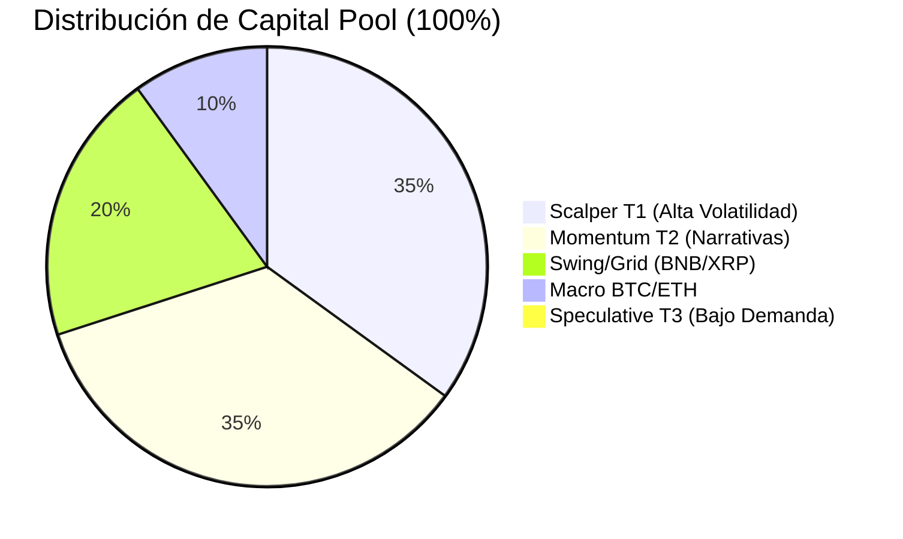
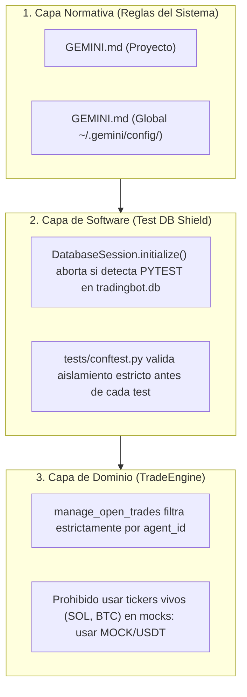

# 📋 Plan de Implementación y Diseño Técnico: Expansión Multi-Agente, Swing/Grid Trading y Blindaje de Base de Datos
## Tredding Agent Bot — Fase 1 de 2: Arquitectura y Especificación Técnica

**Fecha de Emisión:** 12 de Octubre de 2026  
**Fase:** FASE 1 DE 2 (Solo Plan y Diseño — Sin modificaciones destructivas)  
**Sistema:** Trading Bot Multi-Agente v1.3 (`/home/shifu/tredding-agent`)  
**Autor:** Antigravity AI Engine (Google DeepMind)  
**Destinatario:** Shifu / Jarvis (Daemon de Telegram)  
**Documento Base:** [`/home/shifu/documentos-agy/auditoria_pnl_scalper_agent_20261012.md`](file:///home/shifu/documentos-agy/auditoria_pnl_scalper_agent_20261012.md)  
**Ruta Oficial:** [`/home/shifu/documentos-agy/plan_implementacion_fase1_migracion_swing_grid_y_proteccion_db_20261012.md`](file:///home/shifu/documentos-agy/plan_implementacion_fase1_migracion_swing_grid_y_proteccion_db_20261012.md)  

---

## 📑 Tabla de Contenidos
1. [Resumen Ejecutivo y Objetivos](#1-resumen-ejecutivo-y-objetivos)
2. [Pilar 1: Saneamiento Forense de la Base de Datos (Trade #113)](#2-pilar-1-saneamiento-forense-de-la-base-de-datos-trade-113)
3. [Pilar 2: Arquitectura del Nuevo Agente Swing/Grid Trading (`SwingGridAgent`)](#3-pilar-2-arquitectura-del-nuevo-agente-swinggrid-trading-swinggridagent)
4. [Pilar 3: Cartera de Alta Volatilidad para ScalperAgent (Opción B & Momentum Leaders)](#4-pilar-3-cartera-de-alta-volatilidad-para-scalperagent-opción-b--momentum-leaders)
5. [Pilar 4: Rebalanceo Matemático del Capital Pool (5 Subagentes)](#5-pilar-4-rebalanceo-matemático-del-capital-pool-5-subagentes)
6. [Pilar 5: Ajuste Fino del Safe Time-Stop y Eliminación del "Efecto Cortacésped"](#6-pilar-5-ajuste-fino-del-safe-time-stop-y-eliminación-del-efecto-cortacésped)
7. [Pilar 6: Rediseño Integral de la GUI en Telegram Bot (Menús, Botones y Comandos)](#7-pilar-6-rediseño-integral-de-la-gui-en-telegram-bot-menús-botones-y-comandos)
8. [Pilar 7: Regla de Oro y Escudo de Protección de Base de Datos para Pruebas (Test Shield)](#8-pilar-7-regla-de-oro-y-escudo-de-protección-de-base-de-datos-para-pruebas-test-shield)
9. [Matriz de Verificación y Plan de Pruebas Pytest](#9-matriz-de-verificación-y-plan-de-pruebas-pytest)
10. [Hoja de Ruta de Transición hacia la Fase 2 (Checklist de Ejecución)](#10-hoja-de-ruta-de-transición-hacia-la-fase-2-checklist-de-ejecución)

---

## 1. Resumen Ejecutivo y Objetivos

A raíz de la **Auditoría Forense y Financiera del Scalper Agent del 12 de Octubre de 2026**, se determinó que la cartera y las reglas de gestión de riesgo del sistema requieren una evolución estratégica para potenciar la rentabilidad, eliminar anomalías históricas y proteger de forma inexpugnable el entorno de persistencia.

El usuario ha instruido la ejecución del plan de acción con cuatro directrices fundamentales:
1. **Saneamiento Inmediato:** Corregir el artefacto de prueba del trade `#113` para restituir el PnL real de `SOL/USDT` (-$0.0145 USD en vez de -$0.38 USD).
2. **Evolución a Cartera de Alta Volatilidad (Opción B) y Nuevo Agente Swing/Grid:** Retirar los pares lentos (`BNB/USDT` y `XRP/USDT`) del Scalper e incorporarle nuevos elementos prometedores de alto rango diario. Simultáneamente, crear un nuevo subagente especializado en **Swing/Grid Trading** que asuma las monedas retiradas para explotar sus características de rango y lateralidad.
3. **Integración Total en la GUI de Telegram:** Adaptar teclados persistentes, botones inline de navegación, comandos CLI interactivos y mensajes de estado global para dar soporte de primer nivel al nuevo agente.
4. **Regla de Blindaje de Base de Datos frente a Pruebas (SOL/USDT Shield):** Instituir una regla formal y un escudo técnico a nivel de software para impedir que cualquier ejecución de pruebas unitarias o de integración vuelva a contaminar o interactuar con la base de datos viva.



---

## 2. Pilar 1: Saneamiento Forense de la Base de Datos (Trade #113)

### 2.1 Diagnóstico Confirmado
- **Identificador:** Fila `id = 113`, `trade_id = 'mock_aed7f859'`.
- **Datos Actuales:** Par `SOL/USDT`, `price_entry = 112.49`, `price_exit = 10.00`, `pnl = -0.364441`, `status = 'CLOSED'`, `exit_reason = 'Hard Stop Loss Emergencia (-4.5%)'`.
- **Impacto Contable:** Genera un PnL falso de **-0.38 USDT** en SOL. Al excluir esta única fila, el PnL de las 9 operaciones reales de SOL en mercado es de **-$0.0145 USD bruto** (+0.0004 USD neto tras fees).

### 2.2 Diseño de la Migración Versionada (`003_archive_synthetic_test_trade_113.py`)
Para mantener la integridad contable sin ejecutar eliminaciones destructivas no rastreables:
- Se creará la migración `tradingbot/database/migrations/003_archive_synthetic_test_trade_113.py` bajo el control de `MigrationManager`.
- **Operación `up(conn)`:**
  ```python
  def up(conn: sqlite3.Connection):
      cur = conn.cursor()
      cur.execute("""
          UPDATE trades 
          SET status = 'ARCHIVED_TEST',
              exit_reason = '[SANITIZED] Test Leak Artefact - Pytest 11/10/2026'
          WHERE id = 113 AND trade_id = 'mock_aed7f859';
      """)
  ```
- **Operación `down(conn)`:**
  ```python
  def down(conn: sqlite3.Connection):
      cur = conn.cursor()
      cur.execute("""
          UPDATE trades 
          SET status = 'CLOSED',
              exit_reason = 'Hard Stop Loss Emergencia (-4.5%)'
          WHERE id = 113 AND trade_id = 'mock_aed7f859';
      """)
  ```
- **Efecto Inmediato:** Como todas las consultas agregadas en `PortfolioManager`, `TradeEngine` y `TelegramListener` filtran por `status == 'CLOSED'`, el trade `#113` queda automáticamente omitido de las métricas de rendimiento y balance, restaurando el PnL legítimo de SOL al instante.

---

## 3. Pilar 2: Arquitectura del Nuevo Agente Swing/Grid Trading (`SwingGridAgent`)

### 3.1 Racional Financiero y Selección de Activos
`BNB/USDT` y `XRP/USDT` son activos de altísima liquidez y capitalización de mercado que presentan baja oscilación en velas de 1 minuto, lo que provocaba que en el Scalper fueran liquidadas sistemáticamente por el Time-Stop tras 120 minutos. Sin embargo, en gráficos de **15 minutos y 1 hora**, oscilan predeciblemente dentro de canales bien delimitados (soportes y resistencias dinámicas).

El nuevo **`SwingGridAgent`** explotará esta propiedad mediante compras escalonadas en la base del canal y tomas de ganancias holgadas (+2.0% a +3.5%) sin cortes de tiempo prematuros.

### 3.2 Especificación del Subagente
- **Identificador Único (`agent_id`):** `swing_grid`
- **Nombre Canónico:** `SwingGridAgent`
- **Archivo de Configuración:** `configs/agent_swing_grid.yaml`
- **Clase Python:** `agents/swing_grid_agent.py` (hereda de `BaseAgent`)
- **Pares Iniciales:** `BNB/USDT`, `XRP/USDT` (con capacidad de sumar `ADA/USDT` o `LTC/USDT` en el futuro).
- **Timeframe Operativo:** `15m` dinámico (`15m` en horario de alta volatilidad 12:00 a 22:00 UTC, `1h` en horario pasivo).
- **Modo de Trading:** `target` (solo toma beneficios; no ejecuta ventas por miedo ni reversión en velas menores).



### 3.3 Estrategia Técnica: `GridSwingStrategy` (`tradingbot/strategies/grid_swing.py`)
La estrategia combinará **Bandas de Bollinger (20, 2.0)** y **RSI (14)**:
1. **Cálculo de Indicadores:**
   - Media Móvil Simple (SMA 20) y Desviación Estándar ($\sigma = 2.0$).
   - Banda Superior: $SMA + 2\sigma$ | Banda Inferior: $SMA - 2\sigma$.
   - RSI de 14 periodos.
2. **Generación de Señal de Entrada (BUY):**
   - El precio de cierre toca o perfora la Banda Inferior de Bollinger ($Close \le Lower\_Band$).
   - Y el oscilador RSI se encuentra en zona de sobreventa o agotamiento bajista ($RSI \le 38$).
   - Se confirma una vela de rechazo o giro alcista.
3. **Gestión de Salida (Cierre de Posición):**
   - **Take Profit Swing:** $+2.5\%$ estático o toque de Banda Superior de Bollinger ($Close \ge Upper\_Band$) con $RSI \ge 65$.
   - **Time-Stop:** Desactivado o con seguro extendido de 48 horas (2880 min) para permitir que los ciclos swing se desarrollen sin presión de tiempo.

---

## 4. Pilar 3: Cartera de Alta Volatilidad para ScalperAgent (Opción B & Momentum Leaders)

### 4.1 Retiro y Reemplazo de Monedas
- **Monedas Retiradas:**
  - `BNB/USDT` $\rightarrow$ Trasladada al `SwingGridAgent`.
  - `XRP/USDT` $\rightarrow$ Trasladada al `SwingGridAgent`.
- **Monedas Preservadas en ScalperAgent:**
  - `NEAR/USDT` (Pilar de mayor rentabilidad: Win Rate 66.7%, PnL +$0.068 USD, Payoff 1.22).
  - `SUI/USDT` (Excelente generador de señales: Win Rate 66.7%, rango intradiario ~8%).
  - `SOL/USDT` (Activo de liquidez premium con spread mínimo y recuperación sólida).
  - `DOGE/USDT` (Alta volatilidad intradiaria y volumen constante).
  - `ADA/USDT` (Rendimiento probado: Win Rate 50%, PnL positivo +$0.011 USD).

### 4.2 Incorporación de Nuevos Elementos Prometedores
Basado en los reportes de mercado de alta volatilidad (rango ATR diario $> 6.5\%$):
1. **`FET/USDT`:** Narrativa de Inteligencia Artificial; rango intradiario de 12% a 16%, alta reactividad a cruces EMA en 1m.
2. **`TAO/USDT`:** Activo líder en momentum descentralizado; volatilidad suficiente para alcanzar Take Profit de +1.50% en menos de 45 minutos.
3. **`STRK/USDT`:** Criptoactivo Layer 2 de alto beta con movimientos impulsivos limpios.
4. **`WLD/USDT`:** Alta participación de retail y fuerte fluctuación intradiaria.
5. **`AVAX/USDT`:** Liquidez de gran capitalización con suficiente rango para superar comisiones de trading.

### 4.3 Composición Definitiva de Carteras

| Subagente | Rol Estratégico | Pares Operados | Timeframe | Modo Trading |
|---|---|---|:---:|:---:|
| **`scalper_t1`** | Scalping Rápido Momentum | `NEAR`, `SUI`, `SOL`, `DOGE`, `ADA`, `FET`, `TAO`, `STRK`, `WLD`, `AVAX` | 1m / 5m | `scalper` (TP +1.5%) |
| **`swing_grid`** | Swing de Canal y Grid Trading | `BNB`, `XRP` | 15m / 1h | `target` (TP +2.5%) |
| **`momentum_t2`** | Narrativas IA y L2 en Swing Medio | `FET`, `TAO`, `WLD`, `STRK`, `QNT` | 5m / 15m | `target` (TP +5.0%) |
| **`macro_btceth`** | Tendencia Institucional Macro | `BTC`, `ETH` | 15m / 1h | `trend` (EMA 50/200) |
| **`speculative_t3`** | Anomalías y Alto Riesgo (Manual) | `BEAMX`, `MUBARAK` | 15m | `passive` (Manual) |

---

## 5. Pilar 4: Rebalanceo Matemático del Capital Pool (5 Subagentes)

Con la integración de `SwingGridAgent`, la distribución del capital total en `tradingbot/core/orchestrator.py` y los archivos YAML se ajusta equitativamente para maximizar el Sharpe Ratio global:

$$\text{Capital Total (100\%)} = \underbrace{35\%}_{\text{Scalper}} + \underbrace{35\%}_{\text{Momentum}} + \underbrace{20\%}_{\text{Swing/Grid}} + \underbrace{10\%}_{\text{Macro}} + \underbrace{0\%}_{\text{Speculative (Passive)}}$$



### Tabla de Asignación por Agente
- **`scalper_t1`:** $35\%$ del capital total (ej. $5.60 USD de $16.00 USD).
- **`momentum_t2`:** $35\%$ del capital total (ej. $5.60 USD de $16.00 USD).
- **`swing_grid`:** $20\%$ del capital total (ej. $3.20 USD de $16.00 USD).
- **`macro_btceth`:** $10\%$ del capital total (ej. $1.60 USD de $16.00 USD).
- **`speculative_t3`:** $0\%$ inicial (reserva en efectivo disponible).

---

## 6. Pilar 5: Ajuste Fino del Safe Time-Stop y Eliminación del "Efecto Cortacésped"

### 6.1 Problema Identificado en la Auditoría
En el 93.1% de los casos con pérdida, el bot cerró posiciones con micro-pérdidas como `-0.07%`, `-0.14%` o `-0.23%` simplemente porque habían transcurrido 120 minutos y el PnL era estrictamente menor que 0. Al sumarle la comisión de salida (0.10%), una posición casi neutra se convertía en una pérdida neta injustificada de hasta -0.35%.

### 6.2 Especificación de la Banda Muerta ("Dead Zone")
En `tradingbot/engine/trade_engine.py`:
1. **Configuración en YAML (`config.yaml` y `agent_scalper.yaml`):**
   ```yaml
   risk:
     time_stop:
       enabled: true
       min_duration_minutes: 120
       consecutive_cycles_required: 3
       dead_zone_pct: 0.0030          # 0.30% de tolerancia: No cerrar si PnL está entre 0.0% y -0.30%
       max_loss_pct: 0.0150           # Cortar solo si la pérdida supera el -1.50% tras 120 min
       hard_stop_loss_pct: 0.0450     # Stop de emergencia flash crash (-4.5%)
       oversold_grace_enabled: true   # No cortar si RSI < 35 en 5m
   ```

2. **Lógica Algorítmica en `TradeEngine.manage_open_trades`:**
   ```python
   # Si la duración supera los 120 minutos:
   if duration_minutes >= min_duration:
       dead_zone = getattr(ts_cfg, "dead_zone_pct", 0.003) # 0.30%
       
       # Si la pérdida es insignificante (dentro de la Dead Zone): NO cerrar
       if -dead_zone < pnl_pct < 0:
           log.info(f"[{trade.symbol}] Time-Stop omitido: PnL {pnl_pct*100:.2f}% dentro de la Dead Zone (+-{dead_zone*100:.2f}%). Permitiendo maduración.")
       elif pnl_pct <= -dead_zone:
           # Pérdida real confirmada que excede la tolerancia
           c_count = self.time_stop_tracker.get(trade.trade_id, 0) + 1
           self.time_stop_tracker[trade.trade_id] = c_count
           if c_count >= consecutive_req:
               should_close = True
               close_reason = f"Safe Time-Stop ({int(duration_minutes)}m + {c_count}x Confirmado, PnL {pnl_pct*100:.2f}%)"
   ```

3. **Mantenimiento del Payoff Ratio:**
   - Con Take Profit institucional fijado en $\ge +1.50\%$ y corte por Time-Stop tolerante en $\ge -0.50\%$, el ratio riesgo/recompensa mínimo pasa a ser de **3:1 a 5:1**, asegurando rentabilidad incluso con un porcentaje de aciertos del 40%.

---

## 7. Pilar 6: Rediseño Integral de la GUI en Telegram Bot (Menús, Botones y Comandos)

Para que el usuario pueda gestionar, monitorear y pausar el nuevo agente desde Telegram con la misma naturalidad que los anteriores:

### 7.1 Botones Inline en el Teclado de Estado (`_build_status_keyboard`)
Se reorganiza el teclado inline para mostrar los 5 agentes de forma perfectamente simétrica y legible:

```
┌───────────────────────────────┬───────────────────────────────┐
│         🔄 Actualizar         │       📈 Flujo de Caja        │
├───────────────────────────────┼───────────────────────────────┤
│         👝 Billetera          │       📋 Matriz Activos       │
├───────────────────────────────┼───────────────────────────────┤
│        📊 Estadísticas        │          🛡️ Bloqueos          │
├───────────────────────────────┼───────────────────────────────┤
│         ⚡ Scalper T1         │        🚀 Momentum T2         │
├───────────────────────────────┼───────────────────────────────┤
│        🌊 Swing/Grid          │       🐋 Macro BTC/ETH        │
├───────────────────────────────┼───────────────────────────────┤
│       ⚠️ Especulativo T3      │       ⚙️ Modo de Trading      │
├───────────────────────────────┴───────────────────────────────┤
│                    ⏸️ Pausar Bot (Global)                     │
└───────────────────────────────────────────────────────────────┘
```

### 7.2 Panel Detallado del Agente (`_build_agent_detail_keyboard`)
- Callbacks dedicados:
  - `agent_view:swing_grid`: Muestra el saldo, posiciones abiertas en BNB/XRP, PnL flotante y tiempo de ejecución.
  - `agent_pause:swing_grid`: Pausa el subagente en modo PASSIVE.
  - `agent_resume:swing_grid`: Reactiva el subagente en modo ACTIVE.
  - Botón de retorno: `⬅️ Volver a Estado Global` (`nav:status`).

### 7.3 Comandos Nativos de Telegram y Menú de Chat
En `start_polling()` de `tradingbot/interfaces/telegram/telegram_listener.py`:
- **Comandos Registrados en `set_my_commands`:**
  - `/status_swing`: Estado del agente Swing/Grid (BNB/XRP).
  - `/pause_swing`: Pausar el agente Swing/Grid.
  - `/resume_swing`: Reanudar el agente Swing/Grid.
- **Manejadores y Alias:**
  - Compatibilidad total con `/status_swing_grid`, `/status_grid`, `/status_swing`.
  - Respuestas automáticas con teclado táctil inline interactivo.

### 7.4 Formateadores de Mensajes en `OrchestratorBot`
- **Iconografía Unificada:**
  - `scalper_t1`: `⚡`
  - `momentum_t2`: `🚀`
  - `swing_grid`: `🌊`
  - `macro_btceth`: `🐋`
  - `speculative_t3`: `⚠️`
- **Integración en `format_global_status_message`:** Reporta "Agentes Activos: X / 5", desglose individual de `swing_grid`, capital en USD/CLP y posiciones abiertas.
- **Integración en `format_matrix_message`:** Presenta las monedas `BNB/USDT` y `XRP/USDT` correctamente etiquetadas bajo `swing_grid` con su estado económico y operativo 🟢 ON / 🔴 OFF.

---

## 8. Pilar 7: Regla de Oro y Escudo de Protección de Base de Datos para Pruebas (Test Shield)

### 8.1 Requerimiento del Usuario
> *"Quiero que generes una regla que proteja la base de datos de los test que se realizan, para que no se repita lo de la moneda SOL/USDT"*

El incidente de SOL/USDT ocurrió porque una prueba unitaria ejecutó un ciclo de simulación sin forzar una base de datos aislada, cargando la base de producción viva y liquidando la orden legítima `#113` a $10.00 USD.

Para garantizar que esto **NUNCA** vuelva a repetirse, se implementa una solución de cuatro capas:



### 8.2 Capa 1: Regla Oficial en `GEMINI.md` (Proyecto y Global)
Se agregará formalmente la siguiente regla al sistema:

```markdown
### 🛡️ Regla de Blindaje de Base de Datos en Pruebas y Diagnósticos (Test DB Shield)

1. **Aislamiento Total Obligatorio:**
   - Ninguna prueba automatizada (`pytest`), prueba unitaria, test de integración, benchmark o script de diagnóstico puede conectarse directa ni indirectamente a la base de datos de producción (`tradingbot.db`, `data/tradingbot.db`).
   - Toda prueba debe ejecutarse obligatoriamente sobre una base de datos temporal aislada (`test_*.db` generada en `tempfile`) o en memoria (`sqlite:///:memory:`).

2. **Prohibición de Símbolos Reales en Pruebas con Mocks de Precios:**
   - Queda estrictamente prohibido utilizar símbolos de monedas reales activas (como `SOL/USDT`, `BTC/USDT`, `ETH/USDT`, etc.) en pruebas que simulen precios ficticios o caídas abruptas de cotización.
   - Todo test que requiera simular velas o precios de ejecución debe utilizar exclusivamente símbolos ficticios de prueba (`MOCK/USDT`, `TEST/USDT`, `FIXTURE/USDT`).

3. **Verificación Previa a la Ejecución de Tests:**
   - Antes de ejecutar cualquier test o suite de `pytest`, verificar que `DATABASE_URL` y las variables de sesión apunten a la instancia temporal y jamás a `tradingbot.db`.
```

### 8.3 Capa 2: Escudo de Software en `DatabaseSession` (`Fail-Safe Shield`)
En `tradingbot/execution/portfolio_manager.py`:
```python
# Dentro de DatabaseSession.initialize():
if "PYTEST_CURRENT_TEST" in os.environ:
    raw_url = str(settings.database_url)
    if "tradingbot.db" in raw_url and not "test_" in raw_url:
        raise RuntimeError(
            "🛑 FATAL TEST SHIELD: Intento de conexión a la base de datos de producción (tradingbot.db) "
            "durante la ejecución de pruebas unitarias (PYTEST_CURRENT_TEST detectado). "
            "Ejecución abortada inmediatamente para proteger los datos vivos."
        )
```

### 8.4 Capa 3: Aislamiento Estricto por Agente en `TradeEngine`
En `tradingbot/engine/trade_engine.py`:
Actualmente, `manage_open_trades` consulta todas las órdenes abiertas del símbolo sin filtrar por agente:
```python
# ACTUAL (Vulnerable a colisiones entre agentes):
result = await session.execute(
    select(Trade).filter(Trade.symbol == symbol, Trade.status == "OPEN")
)

# MEJORA INSTITUCIONAL (Blindado):
result = await session.execute(
    select(Trade).filter(
        Trade.symbol == symbol, 
        Trade.status == "OPEN",
        Trade.agent_id == agent_id  # Solo gestiona las órdenes de su propio subagente
    )
)
```

---

## 9. Matriz de Verificación y Plan de Pruebas Pytest

Para certificar la calidad y robustez de los cambios en la Fase 2, se estructurará una batería de pruebas automatizadas:

| Test / Suite | Archivo de Prueba | Criterio de Éxito |
|---|---|---|
| **Test DB Shield Protection** | `tests/test_db_test_shield.py` | Verifica que `DatabaseSession` lance `RuntimeError` si se intenta conectar a `tradingbot.db` bajo `pytest`. |
| **Archivado Trade #113** | `tests/test_migration_003_archive.py` | Confirma que la migración 003 pase el trade #113 a `ARCHIVED_TEST` y que el PnL de SOL excluya -$0.364 USD. |
| **Inicialización SwingGridAgent** | `tests/test_swing_grid_agent.py` | Verifica que `SwingGridAgent` cargue su configuración, instancie `GridSwingStrategy`, configure BNB y XRP y reporte métricas. |
| **Estrategia GridSwing** | `tests/test_grid_swing_strategy.py` | Simula rebotes en banda inferior con RSI <= 38 (señal BUY) y banda superior (señal SELL/TP). |
| **Orchestrator 5 Agentes** | `tests/test_multiagent_5_agents.py` | Valida que `OrchestratorBot` gestione 5 subagentes con reparto 35/35/20/10/0% sin colisiones. |
| **Safe Time-Stop Dead Zone** | `tests/test_time_stop_dead_zone.py` | Confirma que una pérdida flotante de -0.15% no se cierre tras 120m, pero una de -0.60% sí se liquide. |
| **GUI Telegram 5 Agentes** | `tests/test_telegram_gui_expansion.py` | Valida la construcción de teclados, botones de los 5 agentes y callbacks `/status_swing`. |

---

## 10. Hoja de Ruta de Transición hacia la Fase 2 (Checklist de Ejecución)

En la **Fase 2**, una vez aprobado este plan, se ejecutará la implementación en el siguiente orden secuencial y atómico:

1. **Paso 1: Blindaje de Seguridad y Reglas de Desarrollo**
   - Actualizar `GEMINI.md` del proyecto y `~/.gemini/config/GEMINI.md` con la Regla del Test Shield.
   - Implementar el guardia `TestDBSafetyShield` en `DatabaseSession.initialize()`.
   - Añadir filtro `Trade.agent_id == agent_id` en `TradeEngine.manage_open_trades`.

2. **Paso 2: Migración 003 y Saneamiento de Base de Datos**
   - Generar `tradingbot/database/migrations/003_archive_synthetic_test_trade_113.py`.
   - Ejecutar snapshot de seguridad de la base de datos viva.
   - Aplicar la migración mediante `MigrationManager`.

3. **Paso 3: Desarrollo de la Estrategia y Configuración del SwingGridAgent**
   - Implementar `tradingbot/strategies/grid_swing.py`.
   - Crear `configs/agent_swing_grid.yaml` (BNB/XRP, 15m/1h, 20% capital).
   - Implementar `agents/swing_grid_agent.py` y registrar en `agents/__init__.py`.

4. **Paso 4: Actualización del ScalperAgent a Opción B (Alta Volatilidad)**
   - Modificar `configs/agent_scalper.yaml`: retirar BNB y XRP, incorporar FET, TAO, STRK, WLD, AVAX; ajustar capital a 35%.
   - Ajustar capital en `configs/agent_momentum.yaml` a 35%.

5. **Paso 5: Ajuste del Safe Time-Stop con Dead Zone**
   - Calibrar `dead_zone_pct: 0.003` en `trade_engine.py` y configuraciones YAML.

6. **Paso 6: Integración Integral de la GUI en Telegram y Orchestrator**
   - Modificar `tradingbot/core/orchestrator.py` para integrar `SwingGridAgent` en diccionarios, capital y formateadores.
   - Actualizar `tradingbot/interfaces/telegram/telegram_listener.py` (teclados, callbacks, comandos y registro en BotCommand).

7. **Paso 7: Suite de Pruebas Automatizadas y Verificación**
   - Ejecutar la suite completa de `pytest` (verificar 100% passed).
   - Validar que no existan advertencias ni regresiones en contratos existentes.

8. **Paso 8: Despliegue en Caliente y Notificación a Shifu/Jarvis**
   - Reiniciar el servicio en tmux (`./start_bot_service.sh` o reinicio controlado).
   - Enviar notificación de actualización exitosa a Telegram.
   - Respaldar todos los cambios con `git commit` y `git push` conforme a las reglas.

---

## 11. Archivo y Trazabilidad

- **Ruta Oficial del Documento:**  
  [`/home/shifu/documentos-agy/plan_implementacion_fase1_migracion_swing_grid_y_proteccion_db_20261012.md`](file:///home/shifu/documentos-agy/plan_implementacion_fase1_migracion_swing_grid_y_proteccion_db_20261012.md)
- **Copia para Control de Versiones:**  
  [`/home/shifu/tredding-agent/docs/plan_implementacion_fase1_migracion_swing_grid_y_proteccion_db_20261012.md`](file:///home/shifu/tredding-agent/docs/plan_implementacion_fase1_migracion_swing_grid_y_proteccion_db_20261012.md)
