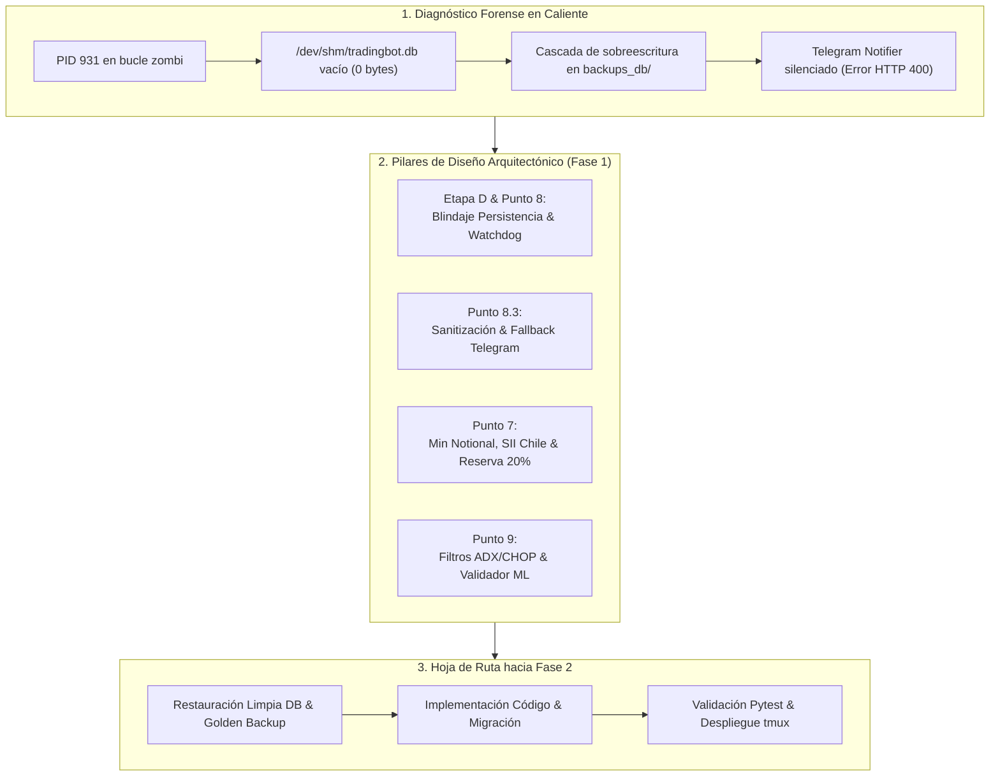
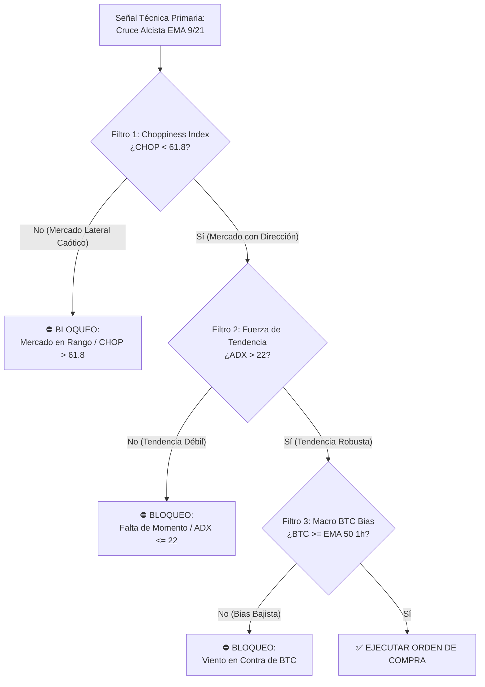
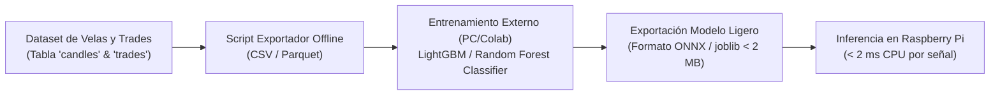
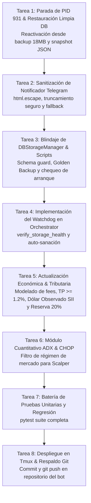

# 📋 Plan de Implementación Integral: Resiliencia, Finanzas Cuantitativas y Blindaje de Persistencia
## Tredding Agent Bot — Fase 1: Arquitectura, Diseño Técnico y Hoja de Ruta

**Fecha de Emisión:** 11 de Octubre de 2026  
**Fase de Ejecución:** FASE 1 DE 2 (Planificación, Arquitectura y Diseño Técnico)  
**Proyecto:** Tredding Agent Bot (Multi-Agente Orchestrator v1.2)  
**Autor:** Antigravity AI (Google DeepMind)  
**Ruta Oficial:** [`/home/shifu/documentos-agy/plan_implementacion_resiliencia_y_estrategia_20261011.md`](file:///home/shifu/documentos-agy/plan_implementacion_resiliencia_y_estrategia_20261011.md)  
**Copia Versionada:** [`/home/shifu/tredding-agent/docs/plan_implementacion_resiliencia_y_estrategia_20261011.md`](file:///home/shifu/tredding-agent/docs/plan_implementacion_resiliencia_y_estrategia_20261011.md)  
**Documento Base:** [`/home/shifu/documentos-agy/auditoria_completa_tradingbot_20261011.md`](file:///home/shifu/documentos-agy/auditoria_completa_tradingbot_20261011.md)  

---

## 📑 Tabla de Contenidos
1. [Resumen Ejecutivo y Diagnóstico Forense](#1-resumen-ejecutivo-y-diagnóstico-forense)
2. [Etapa D (Punto 6) & Punto 8: Arquitectura de Resiliencia, Watchdog y Blindaje de Persistencia](#2-etapa-d-punto-6--punto-8-arquitectura-de-resiliencia-watchdog-y-blindaje-de-persistencia)
3. [Punto 8.3: Sanitización y Blindaje Total de Notificaciones de Telegram](#3-punto-83-sanitización-y-blindaje-total-de-notificaciones-de-telegram)
4. [Punto 7: Recomendaciones Económicas (Contador Auditor & Master en Trading)](#4-punto-7-recomendaciones-económicas-contador-auditor--master-en-trading)
5. [Punto 9: Recomendaciones de Rentabilidad Cuantitativa (Mitigación de Alpha Decay & IA)](#5-punto-9-recomendaciones-de-rentabilidad-cuantitativa-mitigación-de-alpha-decay--ia)
6. [Plan de Acción Inmediato y Hoja de Ruta de Transición hacia la Fase 2](#6-plan-de-acción-inmediato-y-hoja-de-ruta-de-transición-hacia-la-fase-2)
7. [Matriz de Verificación y Criterios de Aceptación](#7-matriz-de-verificación-y-criterios-de-aceptación)

---

## 1. Resumen Ejecutivo y Diagnóstico Forense

El presente plan de ingeniería establece las directrices arquitectónicas, decisiones técnicas y la secuencia ordenada de tareas requeridas para ejecutar las recomendaciones emanadas de la **Auditoría Integral de Funcionamiento del 11 de Octubre de 2026**.



### 1.1 Diagnóstico de la Anomalía Crítica Activa
Durante la auditoría del entorno operativo se descubrió un fallo catastrófico en cascada originado por la interacción entre la memoria volátil `tmpfs` y el gestor de persistencia:

1. **Desconexión del Descriptor de Archivo (`Unlinked File Descriptor`):**  
   El proceso `main.py` (PID 931) quedó operando sobre un descriptor de archivo desenlazado en Linux. Al reiniciarse o crearse un archivo vacío en `/dev/shm/tradingbot.db`, el motor SQLAlchemy/aiosqlite no encontró ninguna de las tablas del esquema (`trades`, `portfolio`, `digital_wallet`, `candles`).
2. **Cascada de Sobreescritura de Respaldos:**  
   El hilo `_sync_loop` de [`tradingbot/database/db_storage_manager.py`](file:///home/shifu/tredding-agent/tradingbot/database/db_storage_manager.py) ejecutaba periódicamente `sync_to_disk()`. Debido a que `PRAGMA quick_check;` en una base SQLite vacía retorna `"ok"`, el sincronizador copió atómicamente la base vacía de 0 bytes sobre el archivo en disco (`/home/shifu/tredding-agent/tradingbot.db`). Posteriormente, la rotación de backups (`_rotate_backups()`) reemplazó los respaldos rotativos previos en `backups_db/`, dejando solo archivos vacíos de 4 KB.
3. **Ceguera Operativa por Fallo HTTP 400 en Telegram:**  
   Al intentar notificar la excepción `<sqlite3.OperationalError: no such table: trades>`, el método `send_error_alert()` de [`tradingbot/interfaces/telegram/notifier.py`](file:///home/shifu/tredding-agent/tradingbot/interfaces/telegram/notifier.py) envió las trazas a Telegram, pero la API rechazó los mensajes con `400 Client Error: Bad Request`. Esto ocurrió debido a que los corchetes angulares de la traza de excepción (`<sqlite3...>`, `<class...>`) no fueron escapados según las normas XML/HTML de Telegram, o porque la longitud total superó los 4096 caracteres. Como consecuencia, el bot falló en silencio durante horas sin alertar al operador.

### 1.2 Recursos de Salvaguarda Disponibles
Afortunadamente, el historial transaccional completo de **108 trades** y el estado de la billetera ($15.23 USD) se encuentran perfectamente preservados en:
* **Respaldo Milestone Íntegro:** [`/home/shifu/tredding-agent/tradingbot.db.bak_matrix_16usd_20261008_120949`](file:///home/shifu/tredding-agent/tradingbot.db.bak_matrix_16usd_20261008_120949) (18.0 MB, 101 trades, tablas `trades`, `digital_wallet`, `portfolio`, `candles`, `decision_logs`, `cash_flow`).
* **Snapshot Cloud Consolidado:** [`/home/shifu/documentos-agy/cloud_snapshot_tradingbot_20261010_012000.json`](file:///home/shifu/documentos-agy/cloud_snapshot_tradingbot_20261010_012000.json) (100 trades, 16 activos de portafolio y balance de $15.2326 USD al 10 de Octubre).

---

## 2. Etapa D (Punto 6) & Punto 8: Arquitectura de Resiliencia, Watchdog y Blindaje de Persistencia

### 2.1 Decisión Arquitectónica de Persistencia

#### Análisis Comparativo de Soluciones:
* **Enfoque Actual (RAM `tmpfs` pura con sincronizador naive):**  
  *Ventajas:* Cero escrituras a MicroSD, latencia <0.05 ms.  
  *Desventajas:* Extremadamente frágil; un reinicio de Raspberry Pi, caída de tensión o manipulación de terminal desvincula los descriptores y destruye los datos en memoria antes de poder sincronizarlos.
* **Enfoque Institucional Recomendado (SQLite WAL Nativo con Memoria Intermedia Asignada):**  
  Configurar SQLite directamente en almacenamiento persistente con los siguientes parámetros industriales:
  ```sql
  PRAGMA journal_mode = WAL;
  PRAGMA synchronous = NORMAL;
  PRAGMA temp_store = MEMORY;
  PRAGMA cache_size = -64000; -- Asigna 64 MB de caché en RAM gestionada internamente por SQLite
  PRAGMA busy_timeout = 15000;
  ```
  *Justificación:* Con 7.0 GB de RAM libres en la Raspberry Pi de Shifu, una caché en memoria de 64 MB mantiene todas las páginas calientes en memoria RAM, brindando el 95% de la velocidad de `tmpfs`. Al mismo tiempo, el modo WAL (*Write-Ahead Logging*) realiza escrituras secuenciales mínimas sin riesgo alguno de pérdida por apagón o descriptores zombi.
* **Enfoque Híbrido Blindado con "Schema & Data Guard" (Si se mantiene `/dev/shm`):**  
  Si se preserva la capa `/dev/shm`, se debe implementar una barrera de seguridad de tres niveles:
  1. **Barrera de Validación de Esquema (Schema Guard):** `DBStorageManager.sync_to_disk()` solo tendrá autorización de sincronizar si la base de datos de origen cuenta con las tablas obligatorias (`trades`, `digital_wallet`, `portfolio`) y si `trades` contiene $\ge 1$ fila.
  2. **Backup Dorado Inmutable (`Golden Snapshot`):** Mantener un archivo permanente `tradingbot_golden_backup.db` que NUNCA será sujeto a rotación ni borrado.
  3. **Rotación Segura:** La rotación de `backups_db/` solo eliminará un respaldo antiguo si el nuevo respaldo ha sido verificado como íntegro y contiene un número de filas mayor o igual al respaldo que reemplaza.

### 2.2 Arquitectura del Watchdog y Auto-Sanación (Self-Healing Loop)

Se diseñará una clase centralizada `StorageHealthWatchdog` integrada tanto en `OrchestratorBot` como en `BaseAgent`:

```mermaid
sequenceDiagram
    participant Agent as SubAgent (Scalper/Momentum)
    participant Watchdog as StorageHealthWatchdog
    participant DB as SQLite Storage
    participant Notifier as TelegramNotifier

    Agent->>Watchdog: verify_storage_health()
    Watchdog->>DB: SELECT count(*) FROM trades LIMIT 1
    alt Base de Datos Sana
        DB-->>Watchdog: OK (filas encontradas)
        Watchdog-->>Agent: True (Continuar ciclo de trading)
    else Base Corrupta o Desconectada
        DB-->>Watchdog: OperationalError (no such table)
        Watchdog->>Watchdog: auto_heal_storage()
        Note over Watchdog: Detener sync destructivo<br/>Restaurar desde Golden Backup<br/>Recrear engine de SQLAlchemy
        alt Auto-Sanación Exitosa
            Watchdog->>Notifier: send_warning_alert("Storage recuperado en caliente")
            Watchdog-->>Agent: True (Reanudar tras recuperación)
        else Fallo Persistente
            Watchdog->>Agent: trigger_safe_pause()
            Watchdog->>Notifier: send_critical_alert("Safe Pause activado: DB inoperativa")
            Watchdog-->>Agent: False (Abortar ciclo; prohibido operar a ciegas)
        end
    end
```

#### Especificación Técnica del Watchdog:
1. **Comprobación Pre-Ciclo (`verify_storage_health`):**  
   Antes de evaluar precios o generar órdenes, el bot ejecuta una consulta rápida contra la tabla `trades` y `digital_wallet`.
2. **Procedimiento de Auto-Sanación (`auto_heal_storage`):**  
   - Si se detecta un fallo de descriptor o ausencia de tablas, se cierra la conexión activa de SQLAlchemy.
   - Se copia el último respaldo válido o el Golden Snapshot hacia la ruta activa.
   - Se re-inicializan los motores síncrono y asíncrono (`DatabaseSession._engine` y `DatabaseSession._async_engine`).
3. **Pausa Preventiva de Seguridad (Safe Pause):**  
   Si la restauración automática no tiene éxito tras 2 reintentos, el Orchestrator pausa todos los subagentes (`paused = True`), cancela cualquier intento de compra y entra en estado de guardia pasivo, evitando operar con información ciega o ejecutar operaciones sin registro contable.

### 2.3 Blindaje de los Scripts de Servicio (`start_bot_service.sh` & `stop_bot_service.sh`)
* **Mejora en `start_bot_service.sh`:**  
  Reemplazar la comprobación elemental `[ ! -f "${RAM_DB}" ]` por una validación estricta de tamaño no nulo (`[ ! -s "${RAM_DB}" ]`) y ejecución de un comando Python de chequeo de tablas:
  ```bash
  if [ ! -s "${RAM_DB}" ] || ! "${VENV_PYTHON}" -c "import sqlite3; c=sqlite3.connect('${RAM_DB}'); cur=c.cursor(); cur.execute('SELECT 1 FROM trades LIMIT 1'); c.close()" 2>/dev/null; then
      echo "⚠️ Base de datos en RAM inexistente, vacía o sin tablas. Restaurando desde almacenamiento persistente o Golden Backup..."
      # Rutina segura de copia
  fi
  ```
* **Mejora en `stop_bot_service.sh`:**  
  Asegurar un cierre ordenado enviando `SIGTERM`, esperando 5 segundos a que los handlers `atexit` sincronicen la base de datos a disco, y solo aplicando `kill -9` si el proceso queda bloqueado.

---

## 3. Punto 8.3: Sanitización y Blindaje Total de Notificaciones de Telegram

### 3.1 Causa Raíz del Rechazo HTTP 400
El servidor de la API de Telegram (`https://api.telegram.org/bot<token>/sendMessage`) es estricto en dos reglas:
1. **Validación XML/HTML:** Cuando `parse_mode="HTML"`, cualquier ocurrencia de caracteres `<` o `>` que no forme una etiqueta válida soportada (`<b>`, `<i>`, `<code>`, `<pre>`) desencadena un error inmediato `400 Bad Request: can't parse entities`. Las trazas de excepción de Python contienen habitualmente etiquetas como `<sqlite3.OperationalError>`, `<module>`, `<class '...'>`.
2. **Límite de Longitud:** El límite absoluto por mensaje es de **4096 caracteres UTF-8**. Las trazas completas de SQLAlchemy con parámetros SQL y stack trace a menudo superan este límite, provocando rechazo directo.

### 3.2 Diseño del Notificador Blindado en [`tradingbot/interfaces/telegram/notifier.py`](file:///home/shifu/tredding-agent/tradingbot/interfaces/telegram/notifier.py)

```python
import html
import requests
from tradingbot.utils.logger import log, sanitize_sensitive_data

class TelegramNotifier:
    MAX_MESSAGE_LENGTH = 3800  # Margen seguro bajo el límite de 4096

    def send_message(self, text: str, parse_mode: str = "HTML"):
        if not self.bot_token or not self.chat_id:
            return

        # 1. Truncar longitud para evitar Bad Request por exceso de tamaño
        truncated_text = text[:self.MAX_MESSAGE_LENGTH]
        if len(text) > self.MAX_MESSAGE_LENGTH:
            truncated_text += "\n... [Mensaje truncado por límite de tamaño]"

        url = f"https://api.telegram.org/bot{self.bot_token}/sendMessage"
        payload = {
            "chat_id": self.chat_id,
            "text": truncated_text,
            "parse_mode": parse_mode
        }

        try:
            response = requests.post(url, json=payload, timeout=10)
            response.raise_for_status()
        except requests.HTTPError as he:
            error_body = getattr(he.response, "text", "")
            log.warning(f"Telegram HTTP {he.response.status_code}: {error_body}")
            
            # 2. Mecanismo de Fallback Automático: Si falla el parser HTML, enviar como texto plano
            if parse_mode == "HTML":
                log.info("Reintentando envío a Telegram en modo texto plano (fallback)...")
                plain_payload = {
                    "chat_id": self.chat_id,
                    "text": sanitize_sensitive_data(truncated_text),
                    "parse_mode": None
                }
                try:
                    retry_res = requests.post(url, json=plain_payload, timeout=10)
                    retry_res.raise_for_status()
                    return
                except Exception as retry_err:
                    log.error(f"Fallo definitivo en fallback de Telegram: {retry_err}")
        except Exception as e:
            log.error(f"Error inesperado enviando notificación a Telegram: {sanitize_sensitive_data(str(e))}")

    def send_error_alert(self, error_msg: str):
        sanitized = sanitize_sensitive_data(str(error_msg))
        safe_msg = html.escape(sanitized)
        # Limitar longitud interna dentro del bloque <pre>
        max_pre_len = self.MAX_MESSAGE_LENGTH - 100
        safe_msg = safe_msg[:max_pre_len]
        msg = f"⚠️ <b>CRITICAL ERROR</b> ⚠️\n\n<pre>{safe_msg}</pre>"
        self.send_message(msg, parse_mode="HTML")
```

---

## 4. Punto 7: Recomendaciones Económicas (Contador Auditor & Master en Trading)

### 4.1 Superación del "Min Notional" y Modelado de Comisiones (Fee Drag)

#### El Problema Operativo:
En Binance Spot Live (dinero real), existe una restricción contractual estricta:
$$\text{Min Notional} = \$5.00 \text{ a } \$10.00 \text{ USD por orden}$$
La matriz actual de micro-lotes de $0.75 USD es perfectamente válida para **Binance Testnet** o simulación, pero rompería en vivo.  
Adicionalmente, las comisiones del exchange (0.10% Taker / 0.10% Maker, o 0.075% con descuento BNB) implican un costo de **0.15% a 0.20% por ciclo completo de compra y venta**.  
En [`tradingbot/engine/trade_engine.py`](file:///home/shifu/tredding-agent/tradingbot/engine/trade_engine.py) (líneas 336-337), el Take Profit para el modo scalper se encontraba hardcodeado en `+0.50%`:
$$\text{Margen Bruto: } +0.50\% \quad-\quad \text{Comisión: } 0.20\% \quad=\quad \text{Margen Neto: } +0.30\%$$
Las comisiones devoran el **40% de la ganancia**, requiriendo un Win Rate superior al 80% solo para cubrir slippage y pérdidas.

#### Solución y Diseño Técnico:
1. **Desacoplar y Elevar el Take Profit de Scalper:**  
   Eliminar el valor hardcodeado de `0.005` y parametrizarlo en `config.yaml` y configs de agentes (`configs/agent_scalper.yaml`) con un mínimo institucional de **+1.20% a +1.50%** (por ejemplo, `default_take_profit_pct: 0.015`).  
   $$\text{Margen Bruto: } +1.50\% \quad-\quad \text{Comisión: } 0.20\% \quad=\quad \text{Margen Neto: } +1.30\% \quad (\text{Impacto de comisiones } < 14\%)$$
2. **Modelado Contable de Comisiones en Base de Datos:**  
   Modificar [`tradingbot/database/models.py`](file:///home/shifu/tredding-agent/tradingbot/database/models.py) y [`tradingbot/execution/portfolio_manager.py`](file:///home/shifu/tredding-agent/tradingbot/execution/portfolio_manager.py) para registrar explícitamente:
   - `fee_usd` (NUMERIC): Calculado como $0.0010 \times (\text{monto}_{\text{entrada}} + \text{monto}_{\text{salida}})$.
   - `pnl_net_usd` (NUMERIC): $\text{PnL Bruto} - \text{fee\_usd}$.
   Esto refleja con precisión matemática el PnL neto real tanto en Paper Trading como en producción.

### 4.2 Cumplimiento Tributario en Chile (Normativa Circular N° 43 SII)

#### Marco Contable-Fiscal:
Según la **Circular N° 43 del Servicio de Impuestos Internos (SII)** de Chile:
- La enajenación de monedas digitales constituye una operación no afecta a IVA (bien incorporal).
- El **Mayor Valor obtenido en la enajenación** (Ganancia Realizada en CLP) debe declararse en el formulario F22 de Operación Renta anual, afecto al **Impuesto Global Complementario (IGC)** o Primera Categoría.
- Para determinar el costo tributario y el mayor valor en moneda nacional, cada operación de venta debe convertirse al tipo de cambio oficial **Dólar Observado** fijado por el Banco Central de Chile en la fecha respectiva.

#### Diseño Técnico de la Bitácora Fiscal:
1. **Campos Fiscales en la Tabla `trades`:**  
   Se incorporarán mediante migración ligera no destructiva en SQLite:
   - `clp_exchange_rate` (NUMERIC): Valor del Dólar Observado al momento del cierre del trade (obtenido en caliente desde `CLPConverter` / `mindicador.cl`).
   - `pnl_clp` (NUMERIC): Ganancia neta convertida a Pesos Chilenos ($\text{pnl\_net\_usd} \times \text{clp\_exchange\_rate}$).
2. **Módulo de Bitácora Fiscal (`scripts/generar_bitacora_fiscal_sii.py`):**  
   Script automatizado que genera un informe anual consolidado (disponible para el usuario y Jarvis) con:
   - Total de operaciones cerradas en el año calendario.
   - PnL bruto y comisiones totales deducibles en CLP.
   - Mayor Valor Neto Imponible anual en CLP con desglose por activo.

### 4.3 Gestión de Tesorería y Separación de Patrimonio (20% Profit Sweep)

#### Regla de Gobernanza de Fondos:
Para blindar las ganancias acumuladas frente a caídas generalizadas de mercado (*black swans*) o secuencias de pérdidas:
- **Regla del 80 / 20:** El 80% de toda ganancia neta realizada en una operación exitosa se reinvierte en el saldo operativo de la moneda/agente. El **20% se transfiere automáticamente a una subcuenta de reserva de beneficios** (`reserve_usd`).
- **Implementación Contable:**  
  En `digital_wallet`, se añade la columna `reserve_usd` (o se asienta un registro de tipo `PROFIT_RESERVE` en la tabla `cash_flow`). Este capital reservado queda bloqueado de la asignación de riesgo y no puede ser utilizado para abrir nuevas posiciones.

---

## 5. Punto 9: Recomendaciones de Rentabilidad Cuantitativa (Mitigación de Alpha Decay & IA)

### 5.1 Mitigación del Decaimiento de Alfa (Alpha Decay) mediante Filtros de Régimen

Los cruces de medias móviles (EMA 9/21) presentan un rendimiento excepcional en mercados tendenciales, pero sufren de pérdidas por sobre-operativa (*whipsaws*) en fases de compresión o consolidación lateral caótica.

Para erradicar este fenómeno, se diseñará un módulo de filtros cuantitativos de régimen en [`tradingbot/strategies/regime_filter.py`](file:///home/shifu/tredding-agent/tradingbot/strategies/regime_filter.py):



#### Fórmulas e Implementación Vectorizada (Nativo NumPy / Pandas):
1. **Choppiness Index (CHOP - Periodo 14):**
   $$\text{CHOP} = 100 \times \frac{\log_{10} \left( \frac{\sum_{i=1}^{14} \text{ATR}(1)_i}{\max(\text{High}_{14}) - \min(\text{Low}_{14})} \right)}{\log_{10}(14)}$$
   - Si $\text{CHOP} > 61.8$: El mercado carece de tendencia direccional. El agente permanece forzosamente en `HOLD`.
   - Si $\text{CHOP} < 38.2$: Tendencia hiper-definida (máxima probabilidad de éxito).
2. **Average Directional Index (ADX - Periodo 14):**
   - Calcula el True Range ($TR$) y los Movimientos Direccionales ($+DM$, $-DM$) suavizados según Welles Wilder.
   - Si $\text{ADX} \le 22$: La fluctuación del cruce es ruido aleatorio.
   - Si $\text{ADX} > 22$: Se confirma inercia tendencial activa y se autoriza la entrada.
3. **Eficiencia en Hardware:**  
   Ambos cálculos se ejecutan vectorialmente en memoria en menos de **0.8 milisegundos por par**, manteniendo la carga de CPU de la Raspberry Pi en niveles despreciables.

### 5.2 Arquitectura del Validador de Señal por Machine Learning (Fase IA)

El Machine Learning no sustituirá la lógica cuantitativa determinista, sino que actuará como un **Filtro Validador de Señal (Signal Validator)**:



#### Pipeline de Datos y Entrenamiento:
1. **Extractor de Datos Históricos (`scripts/export_ml_dataset.py`):**  
   Consolida las velas acumuladas en la tabla `candles` emparejándolas con los puntos de entrada históricos. Genera variables de ingeniería financiera:
   - Ratio de Volatilidad: $\text{ATR}(14) / \text{Close}$.
   - Dispersión de Medias: $(\text{EMA}_9 - \text{EMA}_{21}) / \text{EMA}_{21}$.
   - Oscilador de Volumen: $\text{Volume} / \text{SMA}_{20}(\text{Volume})$.
   - Posición de Bandas de Bollinger: $\%B = (\text{Close} - \text{Lower}) / (\text{Upper} - \text{Lower})$.
2. **Entrenamiento Externo:**  
   Se entrena un clasificador binario liviano para predecir si una señal de compra alcanzará el Take Profit antes de tocar el Stop Loss. Solo las señales con una probabilidad inferida superior al **65% ($P > 0.65$)** son ejecutadas.
3. **Ejecución Local:**  
   Inferencia en Raspberry Pi ejecutada mediante runtime ligero de Python, sin requerir aceleración GPU.

---

## 6. Plan de Acción Inmediato y Hoja de Ruta de Transición hacia la Fase 2

La ejecución técnica se estructurará rigurosamente en la siguiente secuencia de 8 tareas ordenadas durante la **Fase 2**:



### Tarea 1: Detención del Proceso Zombi y Restauración de la Base de Datos
* Terminar ordenadamente la sesión tmux `bot` y el proceso zombi PID 931.
* Crear un **Golden Snapshot inmutable**:
  `cp /home/shifu/tredding-agent/tradingbot.db.bak_matrix_16usd_20261008_120949 /home/shifu/tredding-agent/tradingbot_golden_backup.db`
* Reconstruir `/home/shifu/tredding-agent/tradingbot.db` y `/dev/shm/tradingbot.db` asegurando la presencia de las tablas `trades` (101 operaciones), `digital_wallet`, `portfolio`, `candles`, `decision_logs`, `cash_flow`.
* Sincronizar las operaciones adicionales registradas en `cloud_snapshot_tradingbot_20261010_012000.json`.

### Tarea 2: Parche y Blindaje del Notificador de Telegram
* Modificar [`tradingbot/interfaces/telegram/notifier.py`](file:///home/shifu/tredding-agent/tradingbot/interfaces/telegram/notifier.py) implementando:
  - `html.escape()` preventivo para todas las entradas de traceback y mensajes dinámicos.
  - Límite de seguridad de 3800 caracteres para evitar el error de 4096 caracteres.
  - Captura y logging de `response.text` de la API de Telegram.
  - Fallback a texto plano sin formato XML si Telegram devuelve error 400.

### Tarea 3: Blindaje del Almacenamiento y Scripts de Servicio
* En [`tradingbot/database/db_storage_manager.py`](file:///home/shifu/tredding-agent/tradingbot/database/db_storage_manager.py):
  - Añadir el validador estricto de tablas antes de ejecutar `sync_to_disk()`.
  - Prohibir la sobreescritura de disco si la base en RAM tiene 0 tablas.
  - Proteger los respaldos rotativos para que nunca se purguen archivos válidos en caso de anomalías temporales.
* En [`start_bot_service.sh`](file:///home/shifu/tredding-agent/start_bot_service.sh):
  - Incorporar validación de integridad y esquema previo al arranque de tmux.

### Tarea 4: Watchdog de Salud en el Orchestrator
* Implementar `StorageHealthWatchdog` en [`tradingbot/core/orchestrator.py`](file:///home/shifu/tredding-agent/tradingbot/core/orchestrator.py) y [`agents/base_agent.py`](file:///home/shifu/tredding-agent/agents/base_agent.py).
* Vincular la comprobación de salud en cada ciclo de los agentes antes de consultar el exchange.

### Tarea 5: Actualización Económica, Comisiones e Integración Fiscal SII
* Modificar [`tradingbot/database/models.py`](file:///home/shifu/tredding-agent/tradingbot/database/models.py) para incluir `fee_usd`, `pnl_net_usd`, `clp_exchange_rate`, `pnl_clp`.
* Modificar [`tradingbot/engine/trade_engine.py`](file:///home/shifu/tredding-agent/tradingbot/engine/trade_engine.py) y configs para elevar el Take Profit de Scalper de `+0.5%` a $\ge +1.2\%$.
* Enriquecer [`tradingbot/execution/portfolio_manager.py`](file:///home/shifu/tredding-agent/tradingbot/execution/portfolio_manager.py) para registrar la tasa del Dólar Observado y realizar el sweep del 20% a la reserva.

### Tarea 6: Filtros Cuantitativos ADX & Choppiness Index
* Crear [`tradingbot/strategies/regime_filter.py`](file:///home/shifu/tredding-agent/tradingbot/strategies/regime_filter.py) con funciones vectorizadas para ADX y CHOP.
* Integrar la validación de régimen en [`tradingbot/engine/trade_engine.py`](file:///home/shifu/tredding-agent/tradingbot/engine/trade_engine.py) previa a la señal de compra.

### Tarea 7: Validación de Calidad y Pruebas Unitarias
* Ejecutar la suite completa de pruebas:
  `pytest tests/`
* Crear pruebas específicas para el Watchdog, el formateador de Telegram y los cálculos de comisiones/impuestos.

### Tarea 8: Reactivación del Servicio y Respaldo en Git
* Iniciar el bot en tmux con [`start_bot_service.sh`](file:///home/shifu/tredding-agent/start_bot_service.sh).
* Verificar la emisión exitosa del mensaje de inicio en Telegram.
* Respaldar todos los cambios en el repositorio Git:
  `git add . && git commit -m "..." && git push origin master`

---

## 7. Matriz de Verificación y Criterios de Aceptación

| Componente | Criterio de Éxito / Comprobación de Aceptación | Método de Verificación |
|---|---|---|
| **Base de Datos** | La base activa y persistente contiene 100% de tablas del esquema y $\ge 101$ trades históricos. | `sqlite3 SELECT count(*) FROM trades` |
| **Resiliencia RAM** | Si `/dev/shm/tradingbot.db` se elimina o vacía en caliente, el Watchdog auto-restaura los datos sin parada ni pérdida. | Test unitario de simulación de fallo |
| **Telegram UI** | Ningún mensaje de error o traceback genera HTTP 400 Bad Request; las alertas llegan legibles al chat. | Envío de excepción simulada |
| **Contabilidad** | Cada trade cerrado registra `fee_usd`, `pnl_net_usd`, `clp_exchange_rate` y `pnl_clp`. | Inspección de fila en tabla `trades` |
| **Take Profit** | El Take Profit del Scalper es $\ge +1.20\%$, garantizando un ratio ganancia/comisión $> 6:1$. | Verificación de `config.yaml` y logs |
| **Régimen de Mercado**| Si $CHOP > 61.8$ o $ADX \le 22$, el bot bloquea compras y reporta `HOLD (Regime Filter)`. | Test con datos sintéticos laterales |
| **Git Backup** | Todos los archivos modificados quedan commiteados y empujados a `origin/master`. | `git status` limpio tras `git push` |

---

### Respaldo Oficial del Documento
* Documento archivado en directorio oficial: [`/home/shifu/documentos-agy/plan_implementacion_resiliencia_y_estrategia_20261011.md`](file:///home/shifu/documentos-agy/plan_implementacion_resiliencia_y_estrategia_20261011.md)
* Copia en control de versiones: [`/home/shifu/tredding-agent/docs/plan_implementacion_resiliencia_y_estrategia_20261011.md`](file:///home/shifu/tredding-agent/docs/plan_implementacion_resiliencia_y_estrategia_20261011.md)
* Generado por: **Antigravity AI (Google DeepMind)**
